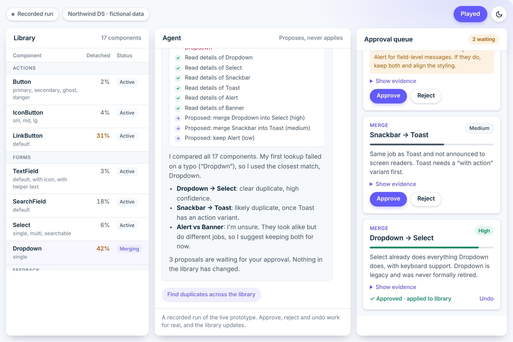
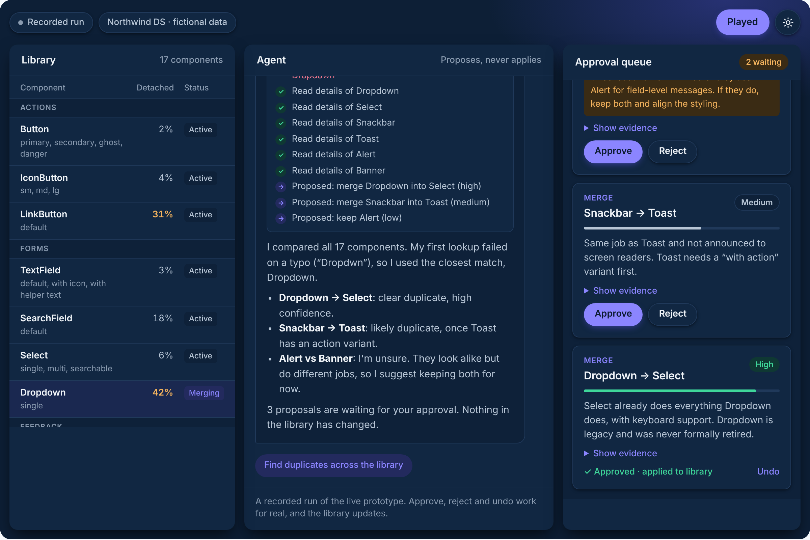

# Design System Audit Agent

**The Lab / 002** · An AI agent that audits a component library, and never changes anything without asking.

In my last role I audited our component library by hand. Two kinds of work were mixed together. Collecting things was slow: usage numbers, detached instances, overlaps, accessibility notes. Judging them was hard: are these two components really the same thing, or do they just look alike?

An agent is good at the first kind of work. The second still needs a person. This prototype explores where that line sits, and how an interface can make it visible.

- **Write-up:** [pueblo-vista.com/design-system-audit-agent](https://pueblo-vista.com/design-system-audit-agent/)
- **Try it:** open [`index.html`](index.html) in a browser. It plays a recorded run; approve, reject and undo work for real.

## Design decisions

**Propose, never apply.** The agent has three tools: list the components, look one up, propose a change. There is no tool that applies anything. Every proposal waits in an approval queue for a person. In an agentic interface, control is designed through the tools you don't give the agent.

**Confidence is shown, not hidden.** Each proposal carries high, medium or low confidence, as a label and as a bar, so it never depends on color alone. Low-confidence proposals must say what would settle the question.

**Mistakes stay on screen.** The work log shows every lookup. A failed lookup (a typo, in the run) stays visible in red, and the agent says which match it assumed instead of guessing silently.

**A no is information.** A rejection reason is passed to the agent with the next message, so it doesn't propose the same thing again. Every decision can be undone.

## What's in here

| Path | What it is |
|---|---|
| [`index.html`](index.html) | The recorded run. Self-contained, scoped CSS, light and dark. Same code as the embed on the site. |
| [`agent/tools.js`](agent/tools.js) | The three tool definitions the model sees (name, description, input schema) and the page code that runs them. |
| [`agent/system-prompt.md`](agent/system-prompt.md) | The agent's instructions: cite the tools' numbers, never claim a change was applied, set confidence honestly, ask when a request is ambiguous. |
| [`prototype/claude-artifact.html`](prototype/claude-artifact.html) | The live prototype. It calls Claude with tool use through the Claude artifact runtime, on the viewer's own Claude account, so it only runs as a Claude artifact. Outside Claude it falls back to the recorded run. |
| [`docs/`](docs) | Screenshots. |

All data is fictional: "Northwind DS" is an invented library of 17 components.

## How it was made

Built in an AI-first workflow together with Claude. The design decisions, what the agent may do, what it must show and where a person steps in, are mine. The UI was set up first as a small design system in Figma, with color variables whose names match the CSS tokens in the code.

---

Paul Pastourmatzis · [pueblo-vista.com/portfolio](https://pueblo-vista.com/portfolio/)
